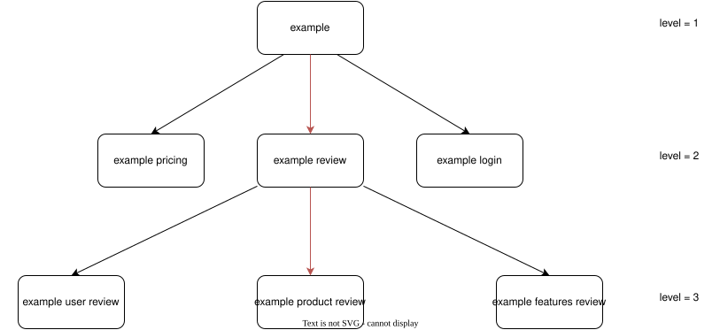

# Keyword Suggestion API

This subproject focuses on providing suggestions with desired depth for a given keyword.

### How to call?
```sh
GET localhost:8080/get_suggestions?keyword=example&hl=en&gl=us&depth=3
```
### What does response look like?
Response is *json* containing all results as an array.
```
...
  {
    "suggested_keyword": "example product review",
    "base_keywords": [
      "example",
      "example review"
    ],
    "level": 2
  },
...
```
**suggested_keyword** : current suggestion\
**base_keywords** : path from initial keyword to the current suggestion\
**level** : path length
### Example structure with depth = 3


### Parameters
+ **keyword** : Keyword to search
+ **hl** : Host language code to restrict results
+ **gl** : Two-letter country code to restrict results
+ **depth** : Suggestion depth
+ **load** : Check database for cached results if set to true
+ **save** : Save results to the database if set to true
+ **proxy** : Proxy to use for request

### Tables for the database

google_suggestions

| suggestion  | base_keywords | level | hl | gl | timestamp
| --- | --- | --- | --- | --- | --- |

google_suggestions_meta

| keyword  | hl| gl | timestamp | depth | amount
| --- | --- | --- | --- | --- | --- |

### Example data

~~Previously collected data using this keyword list can be reached from here~~

Collected datasets are omitted.
